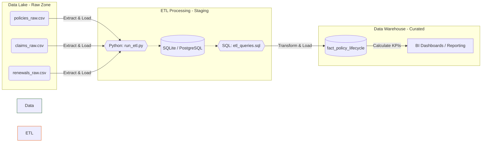

# 🏗️ Data Architecture & Lineage Map

Here is the visual representation of our project. You can recreate this in Draw.io or take a screenshot of this diagram.

### Explanation for Interview:
1. **Raw Zone:** We ingest 50,000+ raw records generated via Python into our local Data Lake simulation.
2. **ETL Processing:** We use a Python runner script to load these CSVs into a relational staging database. Then, complex SQL queries handle the joining and data cleaning.
3. **Data Warehouse:** The transformed data is structured into a single, clean 'Fact Table' which is ready to be connected to PowerBI or Tableau for business reporting.
